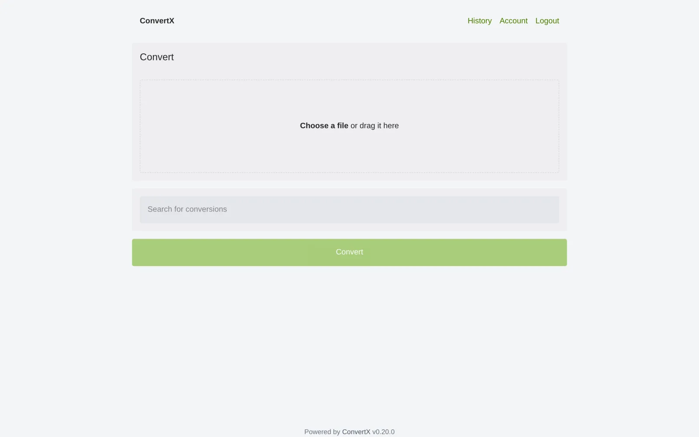
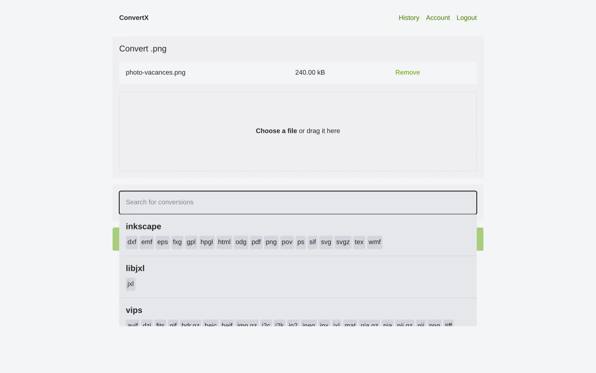
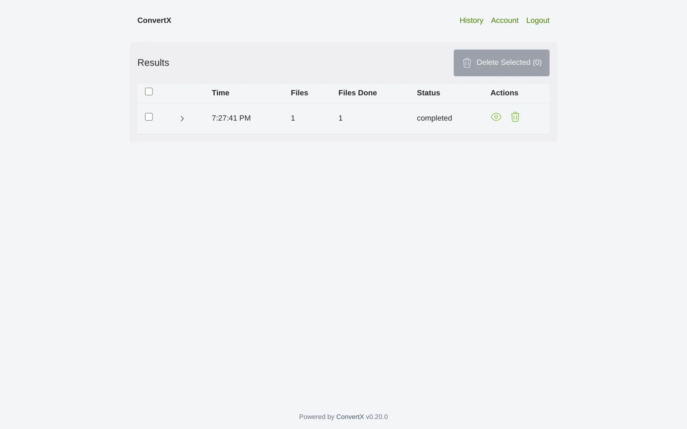

> 💡 **TL;DR**
> - ConvertX Docker : convertisseur de fichiers auto-hébergé qui annonce plus de 1000 formats via FFmpeg, ImageMagick, LibreOffice, Pandoc et Calibre
> - Installation avec un seul docker-compose.yml, port 3000, gratuit et open source (licence AGPL-3.0)
> - Pense à fixer JWT_SECRET et à ne jamais laisser ACCOUNT_REGISTRATION ou ALLOW_UNAUTHENTICATED actifs si l'instance sort du réseau local

## ConvertX Docker : le convertisseur qui tourne chez toi

Tu connais le réflexe. Un fichier `.heic` qui refuse de s'ouvrir, un `.docx` à transformer en PDF, une vidéo à recompresser avant de l'envoyer. Et à chaque fois, le même choix par défaut : un site de conversion en ligne, un upload vers un serveur inconnu, et l'espoir que le fichier ne traîne pas trop longtemps sur leurs disques.

**ConvertX Docker** règle ce problème en le ramenant chez toi. C'est un convertisseur de fichiers web, mais auto-hébergé : tu le déploies en conteneur Docker sur ton NAS ou ton serveur homelab, tu gardes l'interface d'un service en ligne, et tes fichiers ne quittent jamais ton réseau. Le projet est développé par C4illin, écrit en TypeScript avec Bun et Elysia, et publié sous licence AGPL-3.0. Gratuit, sans compte à créer chez un tiers, sans limite de quota.

## Table des matières

## ConvertX Docker : installation via Docker Compose

L'installation de ConvertX Docker tient en un seul fichier. Le projet est distribué en image multi-architecture (amd64 et arm64) sur GitHub Container Registry et sur Docker Hub, ce qui couvre aussi bien un serveur x86 qu'un Raspberry Pi ou un NAS ARM.



Voici le `docker-compose.yml` minimal, à adapter avec ton propre secret :

```yaml
services:
  convertx:
    image: ghcr.io/c4illin/convertx
    container_name: convertx
    restart: unless-stopped
    ports:
      - "3000:3000"
    environment:
      - PUID=1000
      - PGID=1000
      - JWT_SECRET=change-moi-avec-une-vraie-chaine-aleatoire
    volumes:
      - ./data:/app/data
```

Lance le conteneur :

```bash
docker compose up -d
```

`PUID` et `PGID` doivent correspondre à ton utilisateur hôte (vérifiables avec `id -u` et `id -g`). Si tu laisses ces variables vides ou mal réglées, tu tombes sur l'erreur classique « unable to open database file » à cause de permissions refusées sur le dossier `./data`.

Rends-toi ensuite sur `http://ton-ip:3000`. Le premier compte créé devient administrateur, c'est pour ça que le README du projet insiste bien : ne laisse jamais une instance fraîchement installée accessible publiquement avant d'avoir créé ce premier compte toi-même.

Si tu gères déjà plusieurs stacks Docker sur ton serveur, je te conseille de passer par une interface comme [Dockge](/dockge-docker-gestionnaire-stacks-compose/) plutôt que de taper tes `docker compose up -d` à la main service par service. Ça évite d'oublier un `restart: unless-stopped` perdu dans un vieux fichier.

## Les formats supportés : la vraie force de l'outil

Le chiffre « 1000+ formats » affiché par ConvertX Docker n'est pas du marketing gonflé. L'outil ne réinvente rien, il orchestre une pile d'outils déjà éprouvés et leur colle une interface web commune :



- **Images** : ImageMagick et GraphicsMagick pour la grosse majorité des formats bitmap, Vips pour les traitements rapides, libheif pour le HEIC des photos iPhone, libjxl pour le JPEG XL
- **Vectoriel** : Inkscape, Potrace et VTracer pour passer du bitmap au SVG ou inversement
- **Vidéo et audio** : FFmpeg, qui couvre à lui seul la quasi-totalité des conteneurs et codecs courants
- **Documents** : LibreOffice et Pandoc pour le `.docx`, le `.odt`, le Markdown et le PDF, plus XeLaTeX pour les documents composés en LaTeX
- **E-books** : Calibre pour l'`.epub`, le `.mobi` et le `.azw3`
- **3D** : Assimp pour les formats de modèles 3D
- **Données** : Dasel pour jongler entre JSON, YAML et TOML

Concrètement, tu glisses un fichier dans l'interface, tu choisis le format de sortie, ConvertX appelle le bon outil en arrière-plan et te renvoie le résultat. Pas besoin de savoir que telle conversion passe par FFmpeg et telle autre par LibreOffice : l'interface masque tout ça.

## Sécuriser ton instance ConvertX

ConvertX Docker n'est pas pensé par défaut pour vivre sur Internet grand ouvert. Le README du projet est explicite sur ce point, et c'est la partie qu'il ne faut pas zapper si tu veux dormir tranquille.

⚠️ Trois variables à connaître avant d'ouvrir le port vers l'extérieur :

- **`JWT_SECRET`** : signe les jetons de session. Sans valeur définie, ConvertX en génère une aléatoire à chaque redémarrage, ce qui déconnecte tout le monde. Fixe-la une fois pour toutes avec une chaîne longue et aléatoire.
- **`ACCOUNT_REGISTRATION`** : désactivée par défaut. Ne l'active que si tu veux vraiment permettre à n'importe qui de créer un compte sur ton instance.
- **`ALLOW_UNAUTHENTICATED`** : permet d'utiliser l'outil sans connexion. À réserver strictement à un usage local, jamais si l'instance sort de ton réseau.

Autre détail qui piège pas mal de monde : la connexion exige un accès en `localhost` ou en HTTPS. Si tu testes en HTTP simple sur une IP locale, tu dois explicitement passer `HTTP_ALLOWED=true`, sinon le formulaire de connexion refuse de fonctionner.

✅ Ma recommandation : garde ConvertX derrière un reverse proxy qui gère le HTTPS, limite l'accès à ton VPN ou à ton réseau local, et ne touche à `ACCOUNT_REGISTRATION` que si plusieurs personnes doivent vraiment avoir leur propre compte. Pour le reverse proxy justement, si tu veux aussi centraliser l'accès à tes fichiers bruts avant conversion, un outil comme [Filestash](/filestash-docker-navigateur-fichiers-web/) complète bien ce genre de setup.

## Cas d'usage concrets pour ton homelab

Sur le papier, « convertisseur de fichiers » peut sembler être un gadget. Dans les faits, ConvertX Docker est le genre d'outil que tu utilises sans y penser une fois qu'il est en place.



**Nettoyage des photos iPhone.** Tu reçois des `.heic` par AirDrop ou synchro, et ton éditeur préféré ne les ouvre pas. Un glisser-déposer dans ConvertX, conversion en `.jpg`, terminé.

**Préparation de documents avant archivage.** Si tu numérises déjà tes documents avec [Paperless-ngx](/paperless-ngx-docker-guide-auto-hebergement/) pour l'OCR, ConvertX complète bien la chaîne : il te sert à homogénéiser des formats hétérogènes (`.doc` ancien, `.odt`, scans en `.tiff`) avant de les injecter dans ton pipeline documentaire.

**Compression vidéo rapide.** Une vidéo filmée en 4K qui pèse trop pour un envoi par mail ou un stockage long terme. FFmpeg tourne en coulisses, tu règles les arguments de sortie via `FFMPEG_OUTPUT_ARGS` si tu veux forcer un preset précis, par exemple `-preset veryfast`.

**Conversion d'e-books.** Un `.mobi` récupéré qui ne passe pas sur ta liseuse qui ne lit que l'`.epub`. Calibre fait le travail sous le capot, tu n'as rien d'autre à installer.

**Export de données structurées.** Besoin de passer un export JSON en YAML pour un fichier de configuration Kubernetes ou Ansible. Dasel s'en occupe directement dans l'interface, sans ouvrir un éditeur de texte.

## ConvertX vs CloudConvert et les autres convertisseurs en ligne

La vraie question c'est : pourquoi s'embêter à héberger ConvertX Docker soi-même quand CloudConvert, Zamzar ou consorts existent déjà en un clic ?

Trois raisons concrètes :

1. **La confidentialité.** Un relevé bancaire en PDF, un contrat, des photos de famille : ces fichiers transitent par les serveurs d'un tiers le temps de la conversion en ligne. Avec ConvertX, tout reste sur ton infrastructure.
2. **Les quotas.** Les services gratuits limitent la taille des fichiers ou le nombre de conversions par jour. ConvertX Docker n'a aucune limite autre que la puissance de ta machine.
3. **Le coût sur la durée.** CloudConvert facture au-delà d'un certain volume mensuel. ConvertX Docker est gratuit, et le seul coût récurrent est celui de l'électricité de ton serveur, qui tourne probablement déjà pour d'autres services.

En contrepartie, c'est toi qui maintiens le conteneur à jour, qui surveilles l'espace disque utilisé par les fichiers temporaires, et qui gères les montées de version. Si tu es déjà à l'aise avec Docker Compose, le compromis penche clairement du côté de l'auto-hébergement.

## Dépannage : les erreurs les plus courantes

**« Unable to open database file » au démarrage.** Presque toujours un problème de permissions sur le volume `./data`. Vérifie que `PUID` et `PGID` correspondent à l'utilisateur propriétaire du dossier sur l'hôte.

**Impossible de se connecter en HTTP.** Si tu accèdes à l'instance via une IP locale en HTTP simple plutôt qu'en `localhost` ou en HTTPS, ajoute `HTTP_ALLOWED=true` dans tes variables d'environnement.

**Une conversion vidéo qui traîne ou échoue.** FFmpeg peut être gourmand selon le format source. Regarde les arguments passés via `FFMPEG_ARGS` et `FFMPEG_OUTPUT_ARGS`, et limite le nombre de conversions simultanées avec `MAX_CONVERT_PROCESS` si ton serveur n'a pas beaucoup de cœurs disponibles.

**Les fichiers s'accumulent et remplissent le disque.** `AUTO_DELETE_EVERY_N_HOURS` supprime automatiquement les fichiers plus anciens que la durée indiquée, 24 heures par défaut. Mets-le à 0 seulement si tu veux conserver un historique permanent, et dans ce cas surveille l'espace disque.

Pour diagnostiquer n'importe lequel de ces cas sur ConvertX Docker, le réflexe le plus rapide reste de regarder les logs du conteneur en direct. Si tu n'as pas encore d'outil pour ça, [Dozzle](/dozzle-docker-visionneuse-logs-web/) te les affiche dans le navigateur sans taper une seule commande `docker logs`.

## Conclusion

ConvertX Docker coche les cases qui comptent pour un outil homelab : installation en un fichier, gratuit, open source, et surtout utile tous les jours sans qu'on y pense. Ce n'est pas l'outil le plus spectaculaire de la liste, mais c'est exactement le genre de brique qui t'évite de rouvrir vingt onglets de convertisseurs en ligne douteux dès qu'un format ne correspond pas.

Déploie-le avec le `docker-compose.yml` ci-dessus, fixe un vrai `JWT_SECRET`, garde-le derrière ton reverse proxy ou ton VPN, et laisse-le tourner en arrière-plan. Tu l'oublieras jusqu'au prochain fichier récalcitrant, et c'est exactement le but.
