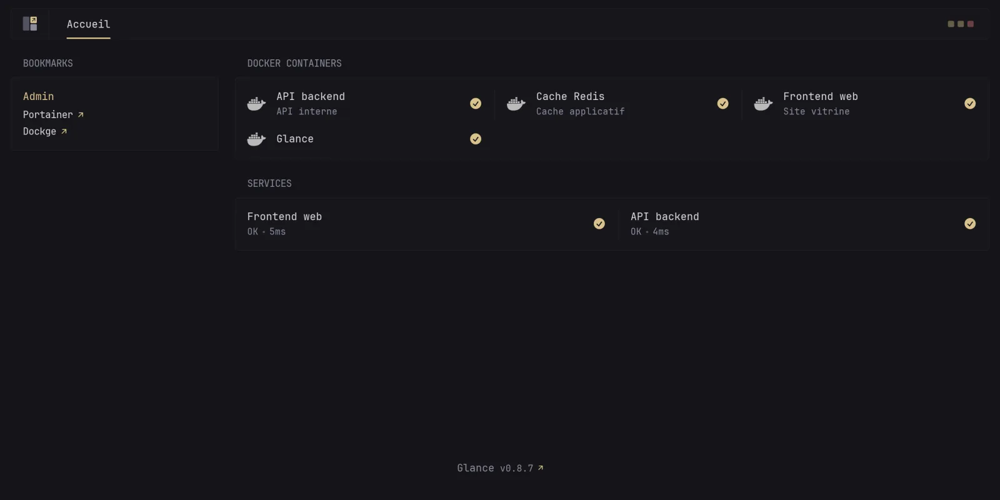
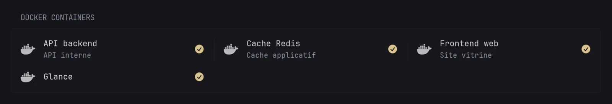

> 💡 **TL;DR**
> - **C'est quoi ?** Glance Docker est un dashboard homelab écrit en Go, ultra léger, configuré entièrement en YAML
> - **Pourquoi ?** Widgets intégrés (météo, RSS, statut Docker, monitoring) sans base de données ni backend lourd
> - **Comment ?** Un conteneur, un fichier `glance.yml`, et ton dashboard tourne en moins de 5 minutes

## Glance Docker : le dashboard homelab qui ne pèse rien

Tu en es où dans ta collection de dashboards homelab ? Moi j'en ai testé une bonne dizaine avant de tomber sur Glance Docker, et c'est celui qui est resté sur mon serveur principal depuis des mois.

La promesse est simple : un seul binaire Go, un fichier YAML, et des widgets qui vont bien au-delà d'une simple liste de liens. Météo, flux RSS, statut de tes conteneurs, cours de bourse, tout ça dans une interface qui charge en une fraction de seconde. Pas de base de données à sauvegarder, pas de build frontend à attendre.

## Table des matières

## Qu'est-ce que Glance ?

Glance est développé par l'organisation GitHub [glanceapp](https://github.com/glanceapp/glance), sous licence AGPL-3.0. C'est un binaire Go unique qui lit un fichier de configuration YAML et sert une page web avec tes widgets.

Contrairement à Homer, qui reste une page statique, Glance tourne un vrai petit serveur qui va chercher des données en direct : météo, flux RSS, statut de tes conteneurs Docker, cours de marché, publications Reddit ou Hacker News. Chez moi, c'est devenu la page d'accueil de mon navigateur sur le serveur.

**Les widgets principaux disponibles :**
- Flux RSS et agrégateurs de news
- Statut des conteneurs Docker (`docker-containers`)
- Monitoring de sites et services (`monitor`)
- Statistiques serveur (`server-stats`, encore en développement côté projet)
- Météo, cours de marché, publications Reddit, chaînes YouTube et Twitch
- Bookmarks, widgets personnalisés (iframe, HTML, extension, API custom)

Spoiler : ça va marcher même si tu n'as jamais touché à du YAML avant. La structure est verbeuse mais lisible.

## Installation de Glance Docker avec Docker Compose

Crée un dossier dédié pour ton instance :

```bash
mkdir -p ~/docker/glance/config && cd ~/docker/glance
```

Le fichier `docker-compose.yml` minimal, directement calqué sur celui du projet :

```yaml
services:
  glance:
    container_name: glance
    image: glanceapp/glance
    restart: unless-stopped
    volumes:
      - ./config:/app/config
    ports:
      - 8080:8080
    environment:
      - TZ=Europe/Paris
```

Lance le conteneur :

```bash
docker compose up -d
```

Sans fichier `config/glance.yml`, Glance démarre avec une configuration par défaut minimale. Ton dashboard est déjà accessible sur `http://ton-ip:8080`, mais sans grand intérêt tant que tu n'as pas écrit ta propre config.

Si tu gères déjà plusieurs stacks Docker sur ton serveur, je te conseille de passer par [Dockge](/dockge-docker-gestionnaire-stacks-compose/) pour éditer et redémarrer tes fichiers compose depuis une interface web plutôt qu'en SSH permanent.

## Configuration du fichier glance.yml

Toute la structure tourne autour de trois niveaux : `pages`, `columns`, `widgets`. Voici un exemple concret, à adapter à ton homelab :



```yaml
pages:
  - name: Accueil
    columns:
      - size: small
        widgets:
          - type: weather
            location: Paris, France

          - type: bookmarks
            groups:
              - title: Admin
                links:
                  - title: Portainer
                    url: http://192.168.1.42:9000
                  - title: Dockge
                    url: http://192.168.1.42:5001

      - size: full
        widgets:
          - type: docker-containers
            hide-by-default: false

          - type: rss
            title: Homelab et self-hosting
            feeds:
              - url: https://www.reddit.com/r/selfhosted/.rss
            limit: 10

theme:
  light: false
  background-color: 240 8 9
  primary-color: 43 50 70
```

Une page ne peut avoir que 3 colonnes au maximum, avec 1 ou 2 colonnes `full` et le reste en `small`. Les couleurs du `theme` s'expriment en HSL (teinte, saturation, luminosité), séparées par des espaces, sans signe pourcentage.

Chaque modification du fichier `glance.yml` est prise en compte après un simple redémarrage du conteneur :

```bash
docker compose restart glance
```

## Widgets Docker, monitor et server-stats : surveiller ton homelab

C'est le widget qui a fini de me convaincre. Le type `docker-containers` liste automatiquement tous les conteneurs présents sur l'hôte, avec leur état, dès que Glance a accès au socket Docker.



Ajoute le montage du socket dans ton `docker-compose.yml` :

```yaml
services:
  glance:
    container_name: glance
    image: glanceapp/glance
    restart: unless-stopped
    volumes:
      - ./config:/app/config
      - /var/run/docker.sock:/var/run/docker.sock:ro
    ports:
      - 8080:8080
```

⚠️ Monter `docker.sock` donne à Glance un accès complet au démon Docker de l'hôte. Fais-le uniquement sur un serveur de confiance, jamais sur une instance exposée directement sur Internet.

Côté widget, les options utiles :

```yaml
- type: docker-containers
  hide-by-default: false
  format-container-names: true
  running-only: true
```

- `hide-by-default` : si `true`, seuls les conteneurs portant le label `glance.hide: false` apparaissent
- `format-container-names` : transforme `jellyfin_media` en `Jellyfin Media`, plus lisible
- `running-only` : ne garde que les conteneurs actuellement démarrés
- `category` : filtre sur le label `glance.category` pour regrouper par usage

Tu peux aussi personnaliser chaque conteneur directement via des labels dans son propre `docker-compose.yml`, par exemple pour ton serveur [Home Assistant](/home-assistant-docker-domotique-guide/) :

```yaml
services:
  homeassistant:
    image: ghcr.io/home-assistant/home-assistant:stable
    labels:
      glance.name: Home Assistant
      glance.url: http://192.168.1.42:8123
      glance.description: Domotique
```

Si tu gères déjà tes conteneurs au quotidien avec [Portainer](/portainer-docker-interface-web-conteneurs/), le widget Docker de Glance ne remplace pas cette interface de gestion : il te donne juste la vue d'ensemble, en lecture, sur ta page d'accueil.

Deux autres widgets complètent la surveillance. Le widget `monitor` ping une liste d'URLs et affiche si elles répondent :

```yaml
- type: monitor
  cache: 1m
  title: Services
  sites:
    - title: Jellyfin
      url: https://jellyfin.tondomaine.com
      icon: /assets/jellyfin-logo.png
    - title: Gitea
      url: https://gitea.tondomaine.com
      icon: /assets/gitea-logo.png
```

Le widget `server-stats` affiche de son côté l'utilisation CPU, RAM et disque de l'hôte local ou distant. Le projet le signale encore comme en développement actif, donc attends-toi à des options qui évoluent entre deux versions :

```yaml
- type: server-stats
  servers:
    - type: local
      name: Services
```

✅ Combine les deux avec le widget `group`, qui empile plusieurs widgets dans des onglets au sein d'une même colonne. Pratique quand tu veux garder une colonne `small` compacte tout en surveillant plusieurs catégories de services.

## Sécuriser et mettre à jour Glance Docker

Glance Docker n'a pas d'authentification native avancée au-delà d'une protection par mot de passe basique (`auth` dans la configuration). Pour un vrai contrôle d'accès, passe par un reverse proxy. Si tu veux chiffrer et sauvegarder cette config YAML au passage, un coup de [BorgBackup](/borgbackup-docker-sauvegarde/) sur ton dossier `~/docker/glance` suffit largement, le fichier pèse quelques kilo-octets.

Côté réseau, garde la même règle que pour tout dashboard homelab : jamais d'exposition directe sur Internet sans authentification devant. Place-le derrière ton VPN ou derrière un reverse proxy avec Authelia ou Authentik en amont si tu veux du SSO.

Si tu exposes quand même Glance Docker sur un sous-domaine interne avec Caddy, la config minimale ressemble à ceci :

```text
glance.tondomaine.com {
    reverse_proxy glance:8080
}
```

Caddy gère le certificat Let's Encrypt tout seul. Ajoute un bloc `basicauth` juste avant le `reverse_proxy` si tu veux une couche de mot de passe supplémentaire en plus de ton VPN.

Comme c'est un simple conteneur, la mise à jour se fait en deux commandes depuis le dossier `~/docker/glance` :

```bash
docker compose pull
docker compose up -d
```

En pratique, je préfère épingler une version précise plutôt que de rester sur `latest`. Ça évite qu'un widget change de comportement du jour au lendemain après un redémarrage automatique du conteneur. Remplace la ligne `image: glanceapp/glance` par `image: glanceapp/glance:v0.8.7` (ou la version courante au moment où tu lis ceci), et monte à la main quand tu as le temps de vérifier le changelog du projet.

Ton fichier `glance.yml` n'est jamais touché par une mise à jour d'image : c'est juste un fichier texte dans ton dossier `config`, donc aucun risque de perdre ta configuration en changeant de version.

## Glance Docker vs Homer vs Dashy : lequel choisir ?

Les trois dashboards répondent à des besoins différents :

| Critère | Glance Docker | Homer | Dashy |
|---------|---------------|-------|-------|
| Architecture | Binaire Go, serveur actif | Page statique | Vue.js avec backend léger |
| Widgets dynamiques | Oui (Docker, monitor, RSS...) | Non | Oui, très complets |
| Configuration | YAML (pages/columns/widgets) | YAML (config.yml) | YAML/JSON |
| Poids à l'exécution | Très léger | Ultra léger | Plus lourd |
| Licence | AGPL-3.0 | Apache-2.0 | MIT |
| Idéal pour | Widgets utiles sans usine à gaz | Minimalistes purs | Personnalisation visuelle poussée |

Si tu veux juste une page de liens qui ne bouge jamais, [Homer](/homer-dashboard-docker-homelab/) fait très bien le travail. Si tu veux pousser la personnalisation visuelle au maximum avec des dizaines de widgets, [Dashy](/dashy-docker-dashboard-homelab/) reste la référence. Glance Docker se positionne entre les deux : des widgets réellement utiles au quotidien, sans la lourdeur d'un frontend complet à maintenir.

💡 À lire aussi : [Dokploy Docker : ton PaaS auto-hébergé (alternative Vercel)](/dokploy-paas-auto-heberge/), dans la même veine que cet article.

💡 À lire aussi : [Pulse Docker : monitoring Proxmox, Docker et Kubernetes avec IA](/pulse-monitoring-proxmox-docker/), dans la même veine que cet article.

## Conclusion

Glance Docker coche les cases que je cherchais depuis longtemps : léger, rapide, configurable en texte brut, et avec un widget Docker qui me donne enfin une vue d'ensemble sans ouvrir Portainer à chaque fois. Si ton homelab tourne déjà sous Docker Compose, l'installation prend moins de temps que cet article à lire.

Commence avec la config minimale, ajoute un widget à la fois, et laisse le fichier `glance.yml` grossir naturellement avec tes besoins. C'est exactement ce genre d'outil qu'on oublie qu'on utilise, parce qu'il fait juste son travail.
