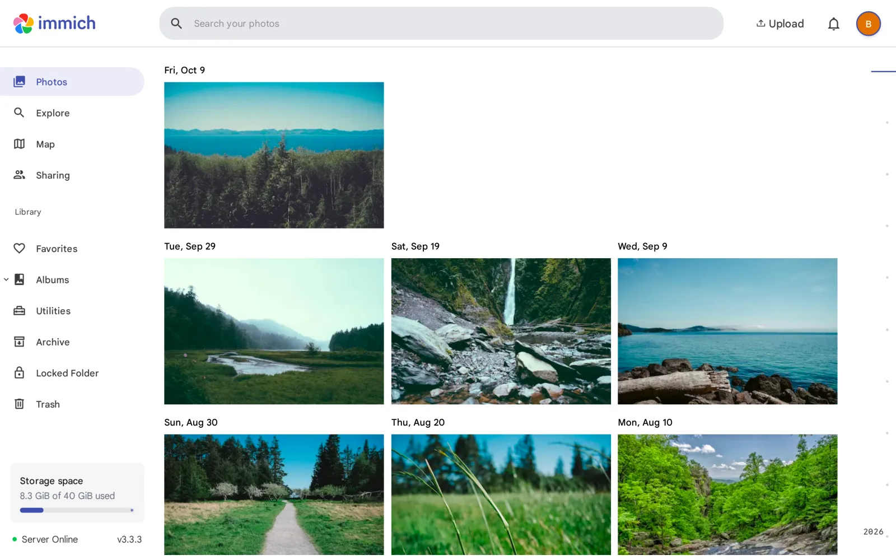
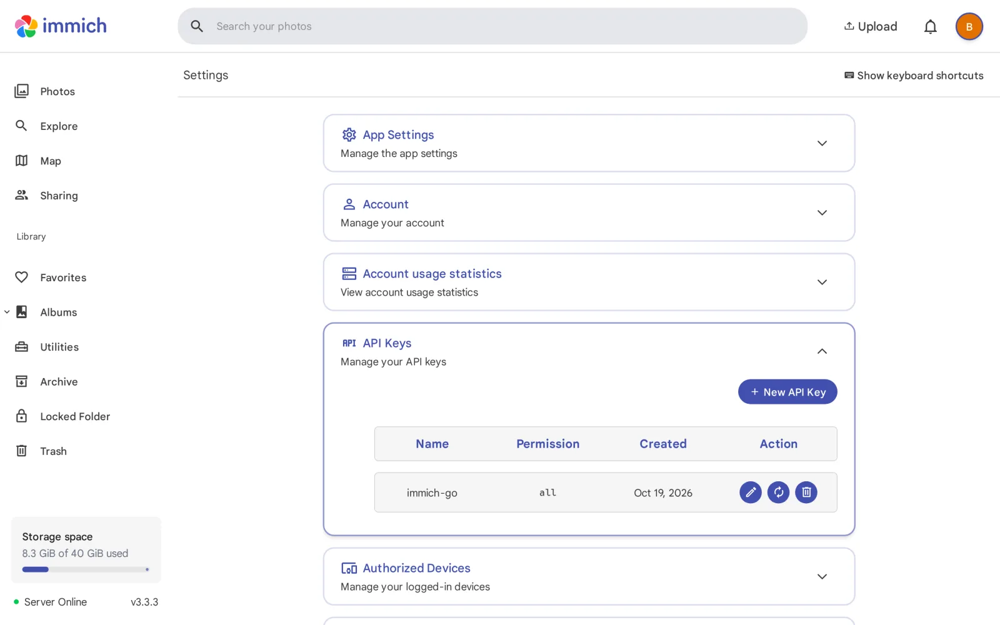
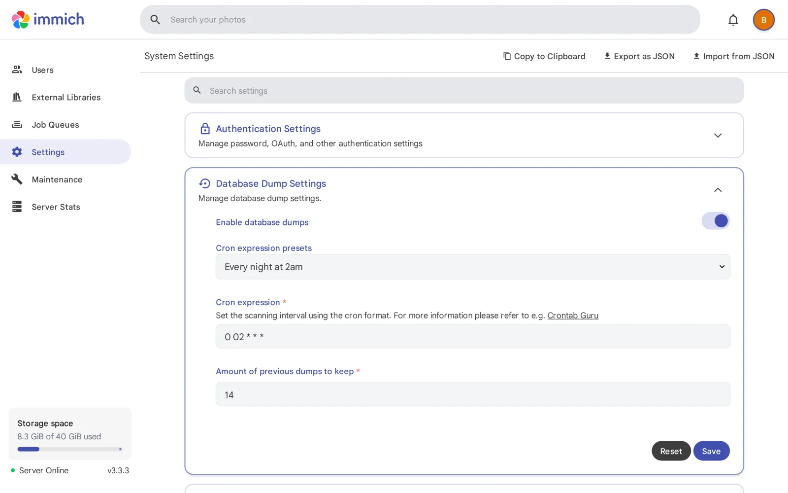

> 💡 **TL;DR**
> - Immich est une alternative open-source à Google Photos : tes photos restent sur ton serveur, pas chez Google.
> - Installation en 5 minutes avec le Docker Compose officiel (v3.3.3 en octobre 2026) : 4 services, 2 fichiers à télécharger.
> - Sauvegarde mobile auto (iOS/Android), reconnaissance faciale, recherche par contenu, édition non destructive depuis la v3.

## Table des matières

## Immich, c'est quoi concrètement

Immich est une application web et mobile qui fait exactement ce que Google Photos fait. Mais sur ton propre serveur. En déployant **Immich Docker** Compose, tu récupères le contrôle total de ta bibliothèque photo en moins de cinq minutes. Pas de cloud américain, pas de collecte de données, pas de tarification qui change tous les six mois.

Le projet est porté par une communauté très active : plus de 116 000 étoiles sur [GitHub](https://github.com/immich-app/immich) et une release mineure quasiment chaque mois. Au moment où j'écris (octobre 2026), la dernière version est la **v3.3.3**. C'est devenu le standard de facto de l'auto-hébergement photo.

Ce que tu peux faire avec Immich :

- **Sauvegarder automatiquement** les photos et vidéos de ton téléphone
- **Rechercher** par contenu ("chat", "plage", "voiture") ou par texte dans l'image (OCR) grâce au machine learning
- **Partager** des albums avec ta famille, même si eux n'ont pas Immich
- **Gérer la géolocalisation** et les métadonnées EXIF, avec une vue carte
- **Retoucher** tes photos sans toucher à l'original (recadrage, rotation, réglages)

L'époque du badge "early access" est derrière lui : le site officiel ne l'affiche plus. Ça ne te dispense pas d'une vraie stratégie de sauvegarde, on y revient plus bas.

## Quoi de neuf dans Immich v3

Si tu as installé Immich en v1 ou v2, voilà ce qui a changé depuis la **v3.0** (juillet 2026) :

- **Édition non destructive sur mobile** : recadrage, rotation et réglages sans écraser le fichier original.
- **Workflows** (en preview) : tu chaînes déclencheurs, filtres et actions dans un éditeur glisser-déposer. La v3.2 a ajouté des déclencheurs sur les tags.
- **Sauvegarde en arrière-plan revue** : sur Android, l'upload couvre toute la bibliothèque en tâche de fond. Sur iOS, synchro et upload tournent en parallèle.
- **Contrôles d'intégrité** : un rapport nocturne signale les fichiers manquants, non suivis ou dont la somme de contrôle ne colle plus.
- **Page "Récemment ajoutés"**, diaporama mobile, OCR sur mobile et upload direct dans un album.
- **v3.3** (octobre 2026) : gestion partagée des personnes, souvenirs d'anniversaire, vignettes de meilleure qualité.

⚠️ **Le piège de la v3** : elle supprime le support de `pgvecto.rs`, l'ancienne extension de recherche vectorielle. Si ton instance date d'avant la v1.133.0 et que tu n'as jamais migré vers VectorChord, suis le guide de migration officiel **avant** de passer en v3. Sinon ta base ne démarrera pas.

## Pourquoi quitter Google Photos

Google Photos a changé son modèle économique en 2021. La sauvegarde gratuite illimitée en qualité compressée a disparu. Aujourd'hui, chaque photo compte dans ton quota Google de 15 Go (partagé avec Gmail et Drive).

Et même si tu payes pour le stockage, il reste une question qui dérange : tes souvenirs intimes sont stockés sur des serveurs dont tu ne contrôles pas les politiques. Ce que Google fait de tes images dépend de conditions d'utilisation qu'il peut modifier quand il veut.

Avec Immich :

- **Tes photos restent chez toi.** Sur ton NAS, ton VPS ou ton serveur dédié.
- **Tu décides quand tout ça disparaît.** Pas de coupure de service surprise.
- **Pas de compression forcée.** Tu stockes les fichiers originaux sans altération.
- **Pas de verrouillage.** Tes fichiers restent des JPEG, HEIC et MP4 classiques dans un dossier, lisibles sans Immich.

## Prérequis

Pour suivre ce guide, il te faut :

- Un serveur Linux 64 bits (Debian ou Ubuntu recommandés), amd64 ou arm64
- **Docker Engine avec le plugin Compose** : la commande est `docker compose`, pas l'ancien `docker-compose` v1 qui n'est plus supporté
- **6 Go de RAM minimum**, 8 Go recommandés. Avec 4 Go, ça passe si tu désactives le machine learning
- 2 cœurs CPU minimum, 4 recommandés. Depuis la v3, le conteneur ML amd64 exige un processeur **x86-64-v2** : les très vieux CPU (avant Nehalem côté Intel) sont exclus
- Un SSD local pour la base PostgreSQL (1 à 3 Go en général), plus l'espace de ta bibliothèque + 10 à 20 % pour les vignettes et vidéos transcodées
- Un nom de domaine et un reverse proxy si tu veux y accéder depuis l'extérieur

Pas encore de Docker sur ta machine ? Mon guide [Docker pour débutants](/docker-debutant-services-auto-heberger/) part de zéro.

🔍 **Note Proxmox** : la doc Immich déconseille de faire tourner Docker dans un conteneur LXC. Si ton homelab tourne sous Proxmox, une petite VM Debian est le choix le plus tranquille. Les nuances entre VM et LXC sont détaillées dans mon [guide des conteneurs LXC Proxmox](/proxmox-lxc-containers-guide/).

## Installation Immich Docker Compose

La stack **Immich Docker** compte quatre services :

- `immich-server` : le moteur principal qui sert l'interface web et l'API
- `immich-machine-learning` : le module qui repère les objets, les visages et le texte dans tes photos
- `redis` : le cache, assuré par Valkey (le fork libre de Redis)
- `database` : PostgreSQL avec l'extension VectorChord, image maintenue par l'équipe Immich

### Télécharger les deux fichiers officiels

Ne recopie pas un compose trouvé sur un blog (même celui-ci) : les images de base de données sont épinglées par empreinte SHA256 et changent d'une release à l'autre. Récupère directement les fichiers de la dernière version :

```bash
mkdir ./immich-app && cd ./immich-app
wget -O docker-compose.yml https://github.com/immich-app/immich/releases/latest/download/docker-compose.yml
wget -O .env https://github.com/immich-app/immich/releases/latest/download/example.env
```

Pour info, voici à quoi ressemble le `docker-compose.yml` de la v3.3.3, commentaires retirés :

```yaml
name: immich

services:
  immich-server:
    container_name: immich_server
    image: ghcr.io/immich-app/immich-server:${IMMICH_VERSION:-release}
    volumes:
      - ${UPLOAD_LOCATION}:/data
      - /etc/localtime:/etc/localtime:ro
    env_file:
      - .env
    ports:
      - '2283:2283'
    depends_on:
      - redis
      - database
    restart: always
    healthcheck:
      disable: false

  immich-machine-learning:
    container_name: immich_machine_learning
    image: ghcr.io/immich-app/immich-machine-learning:${IMMICH_VERSION:-release}
    volumes:
      - model-cache:/cache
    env_file:
      - .env
    restart: always
    healthcheck:
      disable: false

  redis:
    container_name: immich_redis
    image: docker.io/valkey/valkey:9@sha256:c123e3715db63d06d4ad6964884037aa0d5d4d703939b9929954112889708e1d
    healthcheck:
      test: redis-cli ping | grep -q PONG || exit 1
    restart: always

  database:
    container_name: immich_postgres
    image: ghcr.io/immich-app/postgres:14-vectorchord0.4.3-pgvectors0.2.0@sha256:bcf63357191b76a916ae5eb93464d65c07511da41e3bf7a8416db519b40b1c23
    environment:
      POSTGRES_PASSWORD: ${DB_PASSWORD}
      POSTGRES_USER: ${DB_USERNAME}
      POSTGRES_DB: ${DB_DATABASE_NAME}
      POSTGRES_INITDB_ARGS: '--data-checksums'
    volumes:
      - ${DB_DATA_LOCATION}:/var/lib/postgresql/data
    shm_size: 128mb
    restart: always
    healthcheck:
      disable: false

volumes:
  model-cache:
```

Note le volume `${UPLOAD_LOCATION}:/data` : les anciens tutos montent encore `/usr/src/app/upload`, ce chemin est obsolète.

### Configurer le .env

Ouvre le `.env` et ajuste ces lignes :

```bash
UPLOAD_LOCATION=./library
DB_DATA_LOCATION=./postgres
# TZ=Europe/Paris   ← décommente et règle ton fuseau
IMMICH_VERSION=v3
DB_PASSWORD=remplace_par_un_mot_de_passe_fort
DB_USERNAME=postgres
DB_DATABASE_NAME=immich
```

Trois points qui évitent des soirées de debug :

- **`DB_PASSWORD`** : uniquement des caractères `A-Za-z0-9`, sans caractères spéciaux ni espaces. Un `pwgen -s 32 1` fait très bien l'affaire.
- **`DB_DATA_LOCATION`** : jamais sur un partage réseau (NFS, SMB). La base doit rester sur un disque local, idéalement un SSD. Si elle est sur un disque mécanique, décommente `DB_STORAGE_TYPE: 'HDD'` dans le compose.
- **`IMMICH_VERSION=v3`** : c'est une étiquette de version majeure. Tu suis les mises à jour 3.x, mais le passage en v4 devra être volontaire.

### Lancer la stack

```bash
docker compose up -d
```

Le premier démarrage prend une à deux minutes, le temps de tirer les images. Le service répond ensuite sur le port `2283`.

Si Docker râle avec `unknown shorthand flag: 'd' in -d`, tu utilises une version de Docker trop ancienne ou installée depuis les dépôts de ta distribution. Réinstalle-le via la procédure officielle de Docker.

## Premier démarrage et configuration

Ouvre ton navigateur sur `http://IP_DU_SERVEUR:2283`. Un assistant te guide :

1. **Crée le compte administrateur.** C'est le premier utilisateur, il devient automatiquement admin.
2. **Garde les réglages par défaut** pour le stockage et les modèles ML.
3. **Laisse tourner les jobs.** Recherche par contenu, visages et OCR se calculent en tâche de fond, visibles dans Administration > Jobs.

L'interface ressemble furieusement à Google Photos : une timeline, une vue par album, une carte et une page de recherche.



### Reverse proxy

Pour exposer Immich proprement en HTTPS, deux options classiques. Avec [Caddy](/caddy-docker-reverse-proxy-guide/), trois lignes suffisent et le certificat est automatique :

```caddyfile
photos.ton-domaine.fr {
    reverse_proxy immich_server:2283
}
```

Si tu es plutôt [Traefik v3](/traefik-reverse-proxy-docker/), ajoute ces labels au service `immich-server` :

```yaml
    labels:
      - "traefik.enable=true"
      - "traefik.http.routers.immich.rule=Host(`photos.ton-domaine.fr`)"
      - "traefik.http.routers.immich.entrypoints=websecure"
      - "traefik.http.routers.immich.tls.certresolver=letsencrypt"
      - "traefik.http.services.immich.loadbalancer.server.port=2283"
```

Dans les deux cas, le reverse proxy doit partager un réseau Docker avec `immich_server`. Et si tu passes par Nginx, pense à relever `client_max_body_size`, sinon les vidéos lourdes échoueront à l'upload.

## Importer tes photos existantes

### Depuis Google Photos (Takeout)

Le piège classique de Takeout : Google sépare les dates et la géolocalisation dans des fichiers `.json` à côté de chaque photo. Un upload brut te donne une timeline en vrac. La doc Immich recommande donc [immich-go](https://github.com/simulot/immich-go), un outil communautaire (v0.32.0 au moment où j'écris) qui recolle tout ça.



1. Demande l'export Google Photos sur [Google Takeout](https://takeout.google.com/), au format `.zip` (le `.tgz` n'est pas supporté).
2. Dans Immich, crée une clé API : clique sur ton avatar > Paramètres du compte > Clés API.
3. Télécharge le binaire immich-go depuis ses releases GitHub, puis lance :

```bash
immich-go upload from-google-photos \
  --server=http://IP_DU_SERVEUR:2283 \
  --api-key=TA_CLE_API \
  /chemin/vers/takeout-*.zip
```

immich-go recrée tes albums Google Photos et ajoute un tag d'import. Si ton export est découpé en plusieurs archives, passe-les toutes dans la même commande.

### Depuis un dossier local

Pour un dossier de photos classique, le CLI officiel fait le job. Il se lance en conteneur, sans rien installer :

```bash
docker run -it --rm -v "$(pwd)":/import:ro \
  -e IMMICH_INSTANCE_URL=http://IP_DU_SERVEUR:2283/api \
  -e IMMICH_API_KEY=TA_CLE_API \
  ghcr.io/immich-app/immich-cli:latest \
  upload --recursive /import
```

Ajoute `--album-name "Vacances 2019"` pour ranger le tout dans un album, ou `--dry-run` pour voir ce qui serait envoyé sans rien toucher.

Le processus peut être long. Immich indexe chaque fichier, extrait les EXIF, détecte les visages, génère vignettes et vidéos transcodées. Compte plusieurs heures pour quelques dizaines de milliers de photos sur un petit serveur.

## Les applications mobiles

Immich propose des applications iOS et Android gratuites :

- **iOS** : sur l'App Store, recherche "Immich"
- **Android** : sur le Google Play Store, F-Droid ou en APK depuis les releases GitHub

Une fois connectée à ton serveur, l'app active la **sauvegarde automatique** en arrière-plan. Tu peux garder les originaux sur le téléphone ou libérer de l'espace une fois l'upload confirmé. Depuis la v3, l'app sait aussi retoucher une photo sans écraser l'original, lancer un diaporama, et envoyer directement dans un album.

## Sauvegarde et mises à jour

### Ce qu'il faut sauvegarder

Bonne nouvelle : Immich dumpe sa base tout seul. Chaque nuit à 2 h, il écrit un dump PostgreSQL dans `UPLOAD_LOCATION/backups` et garde les 14 derniers (réglable dans Administration > Paramètres).



Côté fichiers, les dossiers critiques de `UPLOAD_LOCATION` sont `library`, `upload`, `profile` et `backups`. Les dossiers `thumbs` et `encoded-video` se régénèrent. La règle simple : sauvegarde tout `UPLOAD_LOCATION` hors de la machine, par exemple avec [Restic](/restic-docker-sauvegarde-moderne/) vers un stockage distant. Un Immich sans sauvegarde externe, c'est juste Google Photos avec un seul disque dur en guise de datacenter.

### Mettre à jour sans casse

```bash
cd ./immich-app
docker compose pull && docker compose up -d
```

Lis les release notes avant chaque mise à jour mineure : Immich casse volontiers des choses (la v3 l'a prouvé avec `pgvecto.rs`), et le **downgrade n'est pas supporté**, même au sein d'une version mineure. C'est pour ça que je déconseille la mise à jour automatique sur Immich. Si tu utilises [Watchtower](/watchtower-mise-a-jour-docker-auto/) pour le reste de tes conteneurs, mets les services Immich en `monitor-only` : tu es prévenu, tu décides.

## Astuces pour aller plus loin

- **Machine learning facultatif** : serveur à 4 Go de RAM ? Désactive le machine learning dans Administration > Paramètres, puis commente le service `immich-machine-learning`. Tu perds la recherche par contenu et les visages, pas la synchronisation.
- **Accélération matérielle** : le compose prévoit des fichiers `hwaccel.transcoding.yml` et `hwaccel.ml.yml` pour Quick Sync, NVENC, VAAPI ou CUDA. Sur un mini-PC Intel, Quick Sync soulage nettement le CPU au transcodage.
- **Stockage sur le NAS** : `UPLOAD_LOCATION` peut pointer vers un montage NFS. La base, elle, reste en local.
- **Multi-utilisateur** : depuis l'interface admin, crée un compte par membre de la famille. Chacun a son espace, les albums se partagent.

💡 **Mon réglage perso** : la bibliothèque est sur un volume NFS monté depuis mon NAS, la base PostgreSQL sur le SSD local de la machine. Le NAS stocke, le serveur calcule.

## Conclusion

Immich est l'alternative la plus aboutie à Google Photos dans l'écosystème open-source. La sauvegarde mobile est fiable, l'interface est moderne, et le machine learning apporte une vraie valeur pour retrouver ses souvenirs. La v3 l'a encore rapproché de l'expérience Google, retouche non destructive comprise.

Son seul défaut ? Il ne fait que de la photo et de la vidéo. Pour une suite complète (documents, agenda, contacts), Nextcloud reste le choix logique. Et si tu hésites encore, [PhotoPrism](/photoprism-docker-galerie-photo/) vise plutôt l'archiviste qui veut cataloguer une bibliothèque existante, quand Immich vise celui qui veut remplacer l'appli photo de son téléphone.

Si Google Photos n'est que le début de ton ménage, mon [guide pour quitter Google](/quitter-google-auto-hebergement/) détaille chaque étape pour reprendre la main sur tes données.
