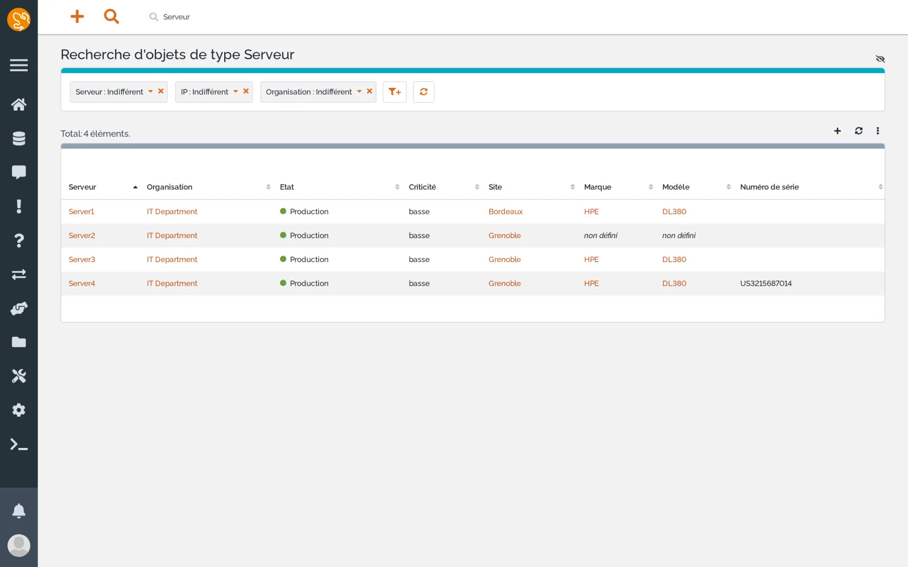
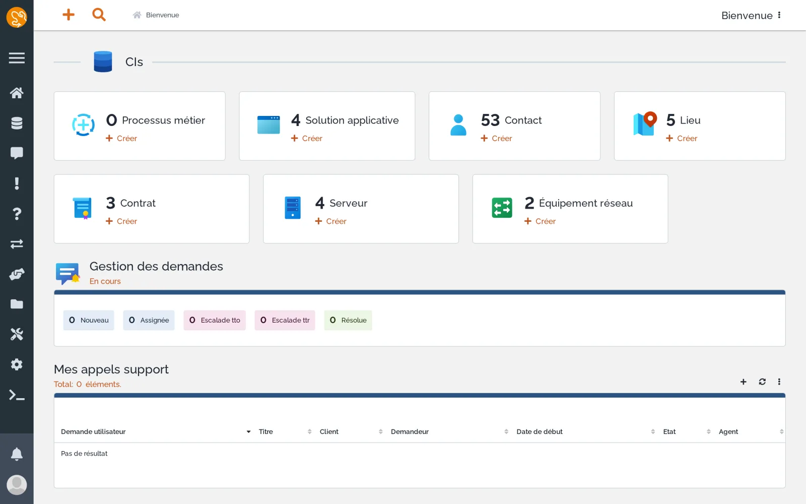
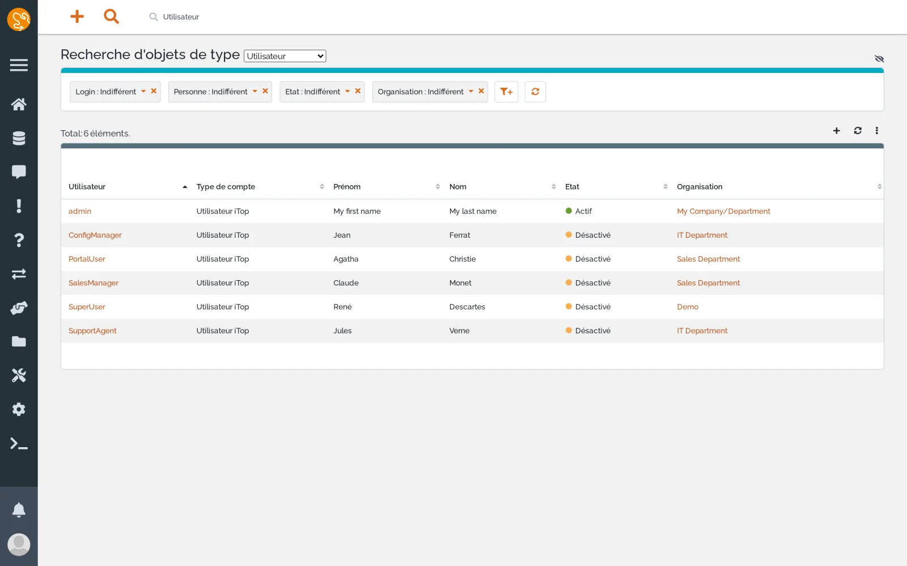

> 💡 **TL;DR**
> - iTop est une CMDB et ITSM open source signée Combodo, pensée CMDB first avec analyse d'impact native
> - Pas d'image Docker officielle : le déploiement iTop Docker repose sur l'image communautaire supervisions/itop et une base MariaDB
> - Comparatif avec GLPI, docker-compose.yml complet, sécurisation, cron et FAQ pour administrer ton parc en autonomie

## iTop Docker : une CMDB open source pour administrer ton parc

Tu gères un parc de serveurs, de VMs ou de postes et tu en as marre du tableau Excel qui ne reflète jamais la réalité du terrain. iTop est fait pour ça. C'est une CMDB (Configuration Management Database) et un ITSM open source édité par Combodo, une société française basée à Échirolles qui développe le projet depuis le milieu des années 2000. Contrairement à beaucoup d'outils ITSM qui collent un module d'inventaire après coup, iTop a été pensé autour de sa CMDB depuis le premier jour : chaque ticket, chaque changement, chaque incident se rattache à des objets réels (un serveur, une application, un contrat) et à leurs relations entre eux.

La dernière version stable, iTop 3.3, sortie en septembre 2026, ajoute une classe Flow pour cartographier les flux de données entre éléments de configuration, une classe Cloud pour les ressources dans le nuage, et un socle pour connecter des LLM à l'assistance diagnostic. Si tu veux héberger ton propre modèle plutôt que de dépendre d'une API tierce pour cette brique IA, j'ai un guide sur [Ollama + Open WebUI Docker : ton ChatGPT 100 % local](/ollama-open-webui-docker-ia-locale/).

Ce guide iTop Docker couvre le déploiement complet avec Docker Compose, la sécurisation de base, l'automatisation du cron interne, et un comparatif honnête avec GLPI pour savoir lequel choisir selon ton contexte.

## Table des matières

## Pourquoi choisir iTop plutôt qu'un autre ITSM

La CMDB d'iTop n'est pas un module optionnel planqué dans un sous-menu. C'est le cœur du produit. Chaque processus ITSM (incidents, problèmes, changements, demandes de service) référence directement les objets de la CMDB, ce qui permet une vraie analyse d'impact : tu casses un serveur, iTop te montre instantanément quelles applications et quels contrats de service sont affectés.



Le modèle de données est extensible sans toucher une ligne de PHP grâce au Data Model Toolkit et à l'ITSM Designer, un éditeur low-code intégré. Tu ajoutes une classe de CI, un attribut personnalisé, une relation entre objets, directement depuis l'interface. Pratique quand ton parc contient du matériel ou des logiciels métier qui ne rentrent pas dans les classes standards fournies d'origine.

Licence AGPL v3 pour l'édition Community, gratuite et sans limitation technique de fonctionnalités. Combodo oriente simplement vers ses éditions payantes, Atelier et Forge, une fois que ton équipe support dépasse la dizaine d'agents et que tu veux du support contractuel en plus. Pour un homelab ou une petite structure, la Community suffit largement à faire tourner ton iTop Docker au quotidien sans jamais sortir la carte bleue.

⚠️ Si ton besoin se limite à suivre quelques tâches perso sans ticketing ni CMDB derrière, iTop est probablement trop lourd pour toi. Regarde plutôt [Vikunja Docker : gestionnaire de tâches auto-hébergé (alternative Todoist)](/vikunja-docker-gestionnaire-taches/) pour un simple suivi de todo sans usine à gaz.

## Déployer iTop Docker avec Docker Compose

Contrairement à GLPI qui a une image officielle `glpi/glpi` maintenue directement par le projet, Combodo ne publie pas d'image Docker officielle pour iTop. L'option la plus maintenue côté communauté est `supervisions/itop`, basée sur `php:apache`, avec un dépôt GitHub actif. C'est celle que ce guide utilise pour monter ton iTop Docker de A à Z.

Prérequis avant de lancer la stack :

- Docker et Docker Compose installés sur ta machine
- 2 Go de RAM minimum, 4 Go conseillés si tu actives la découverte réseau ou l'IA plus tard
- Un nom de domaine ou une IP fixe si tu veux y accéder depuis l'extérieur

Crée un dossier `itop` et un fichier `docker-compose.yml` dedans :

```yaml
services:
  db:
    image: mariadb:11.8
    container_name: itop-mariadb
    restart: unless-stopped
    environment:
      MARIADB_DATABASE: itop
      MARIADB_USER: itop
      MARIADB_PASSWORD: changeme_itop
      MARIADB_ALLOW_EMPTY_ROOT_PASSWORD: "yes"
    volumes:
      - itop_db_data:/var/lib/mysql
    healthcheck:
      test: ["CMD", "healthcheck.sh", "--connect", "--innodb_initialized"]
      interval: 10s
      timeout: 5s
      retries: 5

  itop:
    image: supervisions/itop:3.3
    container_name: itop
    restart: unless-stopped
    ports:
      - "8080:80"
    depends_on:
      db:
        condition: service_healthy
    volumes:
      - itop_conf:/var/www/html/conf
      - itop_data:/var/www/html/data
      - itop_env:/var/www/html/env-production

  cron:
    image: supervisions/itop:3.3
    container_name: itop-cron
    restart: unless-stopped
    user: www-data
    depends_on:
      - itop
    environment:
      AUTH_USER: admin
      AUTH_PWD: changeme_admin
    entrypoint: ["sh", "-c", "sleep 30 && php webservices/cron.php"]

volumes:
  itop_db_data:
  itop_conf:
  itop_data:
  itop_env:
```

Quelques points avant de lancer cette stack :

- Le tag `3.3` fige la version majeure plutôt que `latest`. Une image tierce qui change sans prévenir un jour de déploiement, c'est exactement le genre de surprise qu'on évite.
- Le service `cron` exécute `webservices/cron.php` en boucle pour les tâches planifiées d'iTop (notifications, exports, synchronisations). Les identifiants `AUTH_USER` et `AUTH_PWD` doivent correspondre à un compte iTop avec le profil Administrator, que tu créeras juste après l'installation.
- Les mots de passe `changeme_itop` et `changeme_admin` sont à remplacer avant tout déploiement réel, pas après.

Lance la stack :

```bash
cd itop
docker compose up -d
```

Attends une minute que MariaDB initialise sa base et que le conteneur `itop` démarre correctement.

💡 Si le conteneur `itop` refuse de démarrer ou boucle en erreur 500, inspecte ses couches avant de tout détruire et de repartir de zéro : [Dive Docker : inspecter les couches d'une image](/dive-docker-inspecter-couches-image/) te montre exactement ce que contient l'image `supervisions/itop` et où ça coince.

## Premier lancement, assistant d'installation et sécurisation

Ouvre ton navigateur sur `http://localhost:8080` (ou l'IP de ta machine suivie de `:8080`). L'assistant d'installation d'iTop démarre tout seul.





1. **Langue** : français, logique.
2. **Licence** : AGPL v3, tu acceptes.
3. **Mode d'installation** : choisis « Installation complète d'une nouvelle instance iTop ».
4. **Paramètres de connexion à la base de données** : serveur `db`, utilisateur `itop`, mot de passe celui défini dans ton `docker-compose.yml`, base `itop`.
5. **Modules applicatifs** : coche au minimum le helpdesk ITIL (incidents, demandes de service) et la CMDB. Les modules changements, problèmes et gestion des contrats s'ajoutent si tu en as besoin dès le départ, ou plus tard sans tout réinstaller.
6. **Compte administrateur** : définis un identifiant et un mot de passe solides. C'est ce compte que tu réutiliseras ensuite pour `AUTH_USER` et `AUTH_PWD` dans le service `cron`.

L'installation crée les tables, charge les données de démonstration si tu les as cochées (évite ça en production, ça pollue ta CMDB de fausses fiches), puis te redirige vers la page de connexion.

Une fois connecté, va dans **Administration > Utilisateurs** et vérifie qu'aucun compte de démonstration n'est resté actif. Puis dans **Configuration générale**, mets à jour l'URL de l'application si tu passes derrière un reverse proxy : sinon, les liens générés dans les notifications par email pointeront vers `http://localhost:8080` au lieu de ton vrai domaine public.

✅ Redémarre le conteneur `cron` après avoir créé ton compte administrateur définitif. Sinon les tâches planifiées tournent encore avec les identifiants temporaires de l'installation, et tu le découvres le jour où une notification critique ne part jamais.

Ton iTop Docker est maintenant opérationnel. Reste à l'automatiser proprement et à le comparer sérieusement à l'existant.

## Automatiser les tâches avec le service cron

iTop dépend d'un cron interne pour une bonne partie de son fonctionnement : notifications par email, synchronisations planifiées, nettoyage des anciennes données, exécution des règles d'auto-remédiation si tu les configures un jour. Sans lui, les tickets s'accumulent sans que personne ne soit prévenu.

Le service `cron` du compose ci-dessus tourne en continu et appelle `webservices/cron.php` avec les identifiants du compte administrateur. Vérifie qu'il tourne bien :

```bash
docker compose logs -f cron
```

Tu dois voir des lignes d'exécution régulières, sans erreur d'authentification. Une erreur 401 ici signifie presque toujours que `AUTH_USER` ou `AUTH_PWD` ne correspond plus à un compte actif, typiquement après avoir désactivé le compte de démo pendant la sécurisation.

Comme l'image `supervisions/itop` n'est pas publiée par Combodo, surveille ses mises à jour plutôt que de les découvrir au hasard d'un `docker compose pull`. [DIUN Docker : être alerté quand une image change sur le registre](/diun-docker-notification-image-registry/) te prévient dès qu'une nouvelle version sort, pour que tu choisisses toi-même quand migrer ton iTop Docker plutôt que de le découvrir après coup, un vendredi soir.

Pense aussi à sauvegarder régulièrement. Un simple script cron sur l'hôte suffit :

```bash
#!/bin/bash
docker exec itop-mariadb mysqldump -u itop -pchangeme_itop itop > /backup/itop-$(date +%F).sql
```

Pour la mise à jour, fige d'abord le nouveau tag dans ton `docker-compose.yml`, puis :

```bash
docker compose pull
docker compose up -d
```

iTop détecte automatiquement qu'une migration de schéma est nécessaire et te guide dans l'interface au prochain accès admin. Sauvegarde toujours ton iTop Docker avant de lancer cette mise à jour, la commande de dump ci-dessus ne te protège de rien si tu zappes cette étape par flemme.

## iTop vs GLPI : CMDB first ou ITSM tout-en-un

GLPI (édité par Teclib, licence GPL v3) est plus connu, surtout en France, et il a l'avantage d'être réellement tout-en-un : helpdesk, inventaire automatique via agent, gestion de parc, le tout dans une seule interface pensée pour démarrer vite. Si ton équipe IT est encore en train de construire sa maturité ITIL, GLPI reste probablement le choix le plus rapide à faire adopter par tes collègues.

iTop part de l'autre sens. Sa CMDB est le socle, pas une fonctionnalité annexe, avec un modèle de relations entre CI plus riche et une analyse d'impact native. Si ton organisation gère déjà des processus incident, problème et changement formalisés, et que tu veux une CMDB capable de représenter des dépendances complexes (une application qui dépend d'une base, qui dépend d'un cluster, qui dépend d'un contrat de maintenance), iTop répond mieux à ce besoin précis.

| Critère | iTop | GLPI |
|---|---|---|
| Éditeur | Combodo (France) | Teclib (France) |
| Licence | AGPL v3 | GPL v3 |
| Approche | CMDB first, impact natif | ITSM et inventaire unifiés |
| Courbe d'apprentissage | Plus raide au départ | Démarrage plus rapide |
| Extensibilité sans code | ITSM Designer intégré | Plugins communautaires |

En pratique :

- Équipe en train de structurer son support IT, besoin de démarrer vite : GLPI
- Organisation avec des processus ITIL déjà formalisés, CMDB complexe à modéliser : iTop
- Simple inventaire de matériel sans ticketing lourd : regarde plutôt Snipe-IT, plus léger que les deux

Aucun des deux n'est strictement supérieur à l'autre. Ils répondent à des priorités différentes, et rien ne t'empêche de tester les deux côte à côte avant de trancher, vu que les deux se déploient en quelques minutes avec Docker Compose.

## FAQ

**L'édition communautaire d'iTop est-elle limitée en nombre d'utilisateurs ?**
Techniquement non, mais Combodo recommande la Community au-delà d'une dizaine d'agents support uniquement si tu es à l'aise pour t'auto-dépanner. Passé ce seuil, les éditions payantes Atelier et Forge ajoutent du support officiel.

**Peut-on migrer mes fiches GLPI vers iTop ?**
Pas de bouton magique. Il faut exporter tes données GLPI en CSV, mapper les champs vers les classes de la CMDB iTop, puis importer via le module Data Administration. Compte une bonne journée pour un parc moyen.

**L'image Docker communautaire est-elle fiable pour la production ?**
Elle n'est pas publiée par Combodo, donc vérifie la cadence de mise à jour du mainteneur (le dépôt [Super-Visions/docker-itop](https://github.com/Super-Visions/docker-itop) sur GitHub), fige un tag de version précis plutôt que `latest`, et garde des sauvegardes régulières de tes volumes avant toute mise à jour.

## Conclusion

Tu as maintenant un iTop Docker complet : CMDB, helpdesk ITIL, cron pour les tâches planifiées, et de quoi comparer sérieusement avec GLPI avant de t'engager pour de bon. La vraie question c'est rarement « quel outil est objectivement le meilleur », mais plutôt lequel colle le mieux à tes processus actuels. Si ta CMDB doit représenter des dépendances compliquées entre applications, contrats et infrastructure, iTop vaut le détour. Si tu veux juste un helpdesk qui marche vite sans trop réfléchir, GLPI reste solide.

Dans les deux cas, sauvegarde tes volumes Docker avant chaque mise à jour, et surveille l'image communautaire comme n'importe quel composant tiers de ton infra. Bon déploiement, et n'hésite pas à documenter tes classes de CI au fur et à mesure : une CMDB qui n'est jamais tenue à jour finit exactement comme ton vieux tableau Excel.
