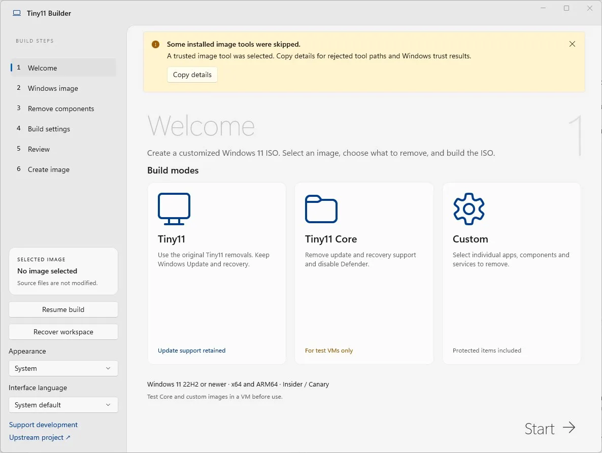
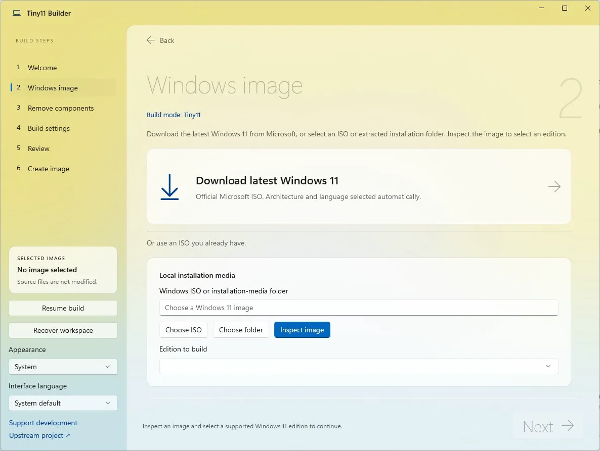
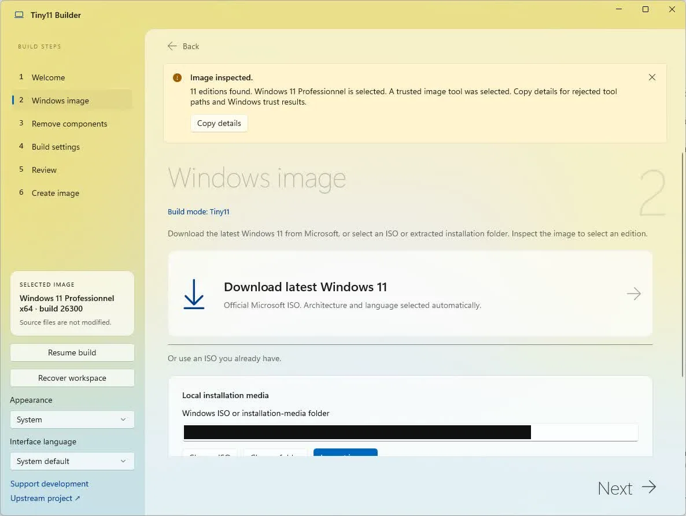
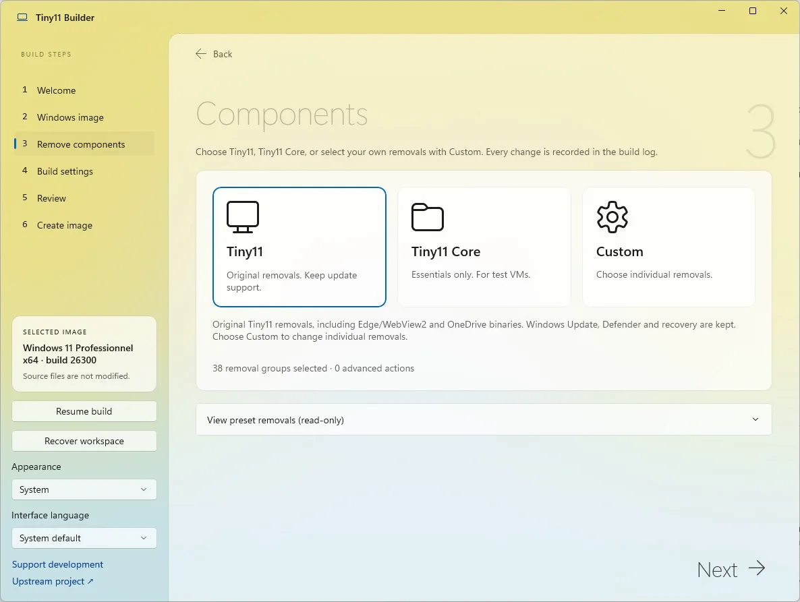
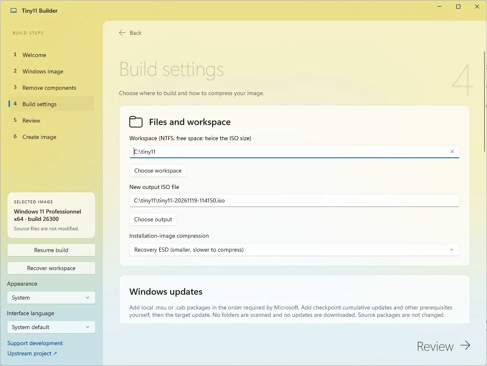
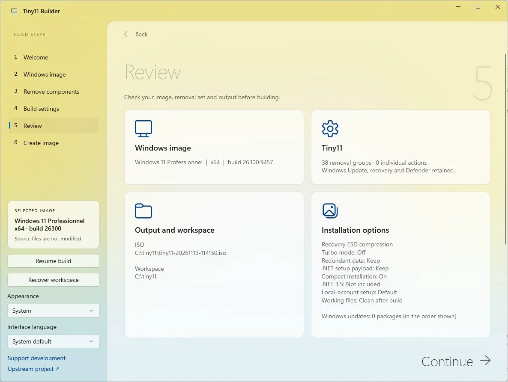
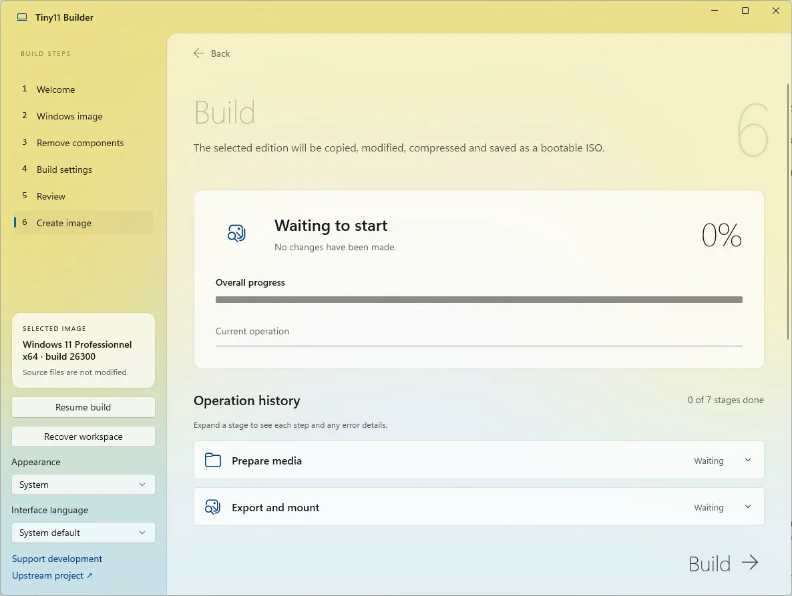

> 💡 **TL;DR**
> - Tiny11 Builder est une app WinUI gratuite et open source qui fabrique une image Windows 11 allégée à partir d'une ISO Microsoft officielle, sans toucher au fichier source
> - Trois modes au choix : Tiny11 (léger mais maintenable), Custom (tu choisis les suppressions) et Tiny11 Core (jetable, pour VM de test uniquement)
> - Compatible Windows 11 22H2 et plus récent, en x64 ou ARM64, pas de support Windows Server
> - Teste toujours l'ISO générée dans une VM isolée avant de songer à la déployer sur une vraie machine

## Tiny11 Builder : une image Windows 11 plus légère, sans mystère

Windows 11 arrive avec son lot d'applis que personne n'a demandées. Clipchamp, Xbox, trois versions de Copilot, OneDrive qui se lance tout seul, Dev Home qui squatte le menu démarrer. Tu formates, tu réinstalles, et dix minutes plus tard t'es déjà en train de désinstaller des trucs à la main. Chez moi, ce rituel revenait à chaque nouvelle VM de test, et à force, ça use.

**Tiny11 Builder** règle ce problème à la source. C'est un outil développé par **ntdevlabs**, un projet communautaire hébergé sur GitHub, qui prend ton image Windows 11 officielle et en ressort une version débarrassée du superflu. Le fichier source original n'est jamais modifié : Tiny11 Builder travaille sur une copie, dans un dossier de travail dédié, et te livre une nouvelle ISO prête à l'emploi.

Le projet a pas mal évolué. Au départ, c'était une poignée de scripts PowerShell. Aujourd'hui, la version de référence est une vraie application WinUI (la 0.2.0, sortie fin octobre 2026), avec son propre runtime .NET embarqué, des recettes de suppression réutilisables et un mode Turbo pour accélérer le traitement. Les scripts PowerShell historiques existent toujours dans le dépôt, pour ceux qui veulent scripter leurs builds, mais l'app est désormais le point d'entrée recommandé.

Spoiler : ça va marcher, à condition de respecter deux ou trois règles de base qu'on va détailler.

## Table des matières

## Les trois modes de Tiny11 Builder

Avant de lancer quoi que ce soit, choisis ton mode. C'est la décision la plus importante de tout le processus, parce qu'elle détermine si ton image reste utilisable sur le long terme.



**Tiny11** est le mode par défaut, celui que je recommande à 90 % des gens. Il retire les applis inutiles (Clipchamp, Xbox, Dev Home, une partie des composants Copilot) mais garde Windows Update, Windows Defender et la récupération système intactes. Tu peux continuer à installer des mises à jour, ajouter des langues ou activer des fonctionnalités après coup, exactement comme sur une installation classique.

**Custom** te laisse la main sur la liste des suppressions. Tu coches ce que tu veux virer, tu peux sauvegarder ta sélection comme recette et la réappliquer sur la prochaine ISO. Pratique si tu fabriques des images pour plusieurs postes avec des besoins légèrement différents.

**Tiny11 Core** va beaucoup plus loin. Il supprime le Component Store (WinSxS), Windows Update et l'environnement de récupération WinRE, et désactive Windows Defender. Le résultat démarre vite et pèse nettement moins lourd, mais il devient impossible d'ajouter une langue, une mise à jour ou une fonctionnalité après la création. Le projet le dit lui-même : ce mode n'est pas fait pour un usage quotidien.

⚠️ **Attention** : Tiny11 Core n'est pas une alternative légère à Windows 11, c'est un outil de test jetable. On y revient plus bas, parce que c'est le piège dans lequel tombent la plupart des gens qui découvrent l'outil.

## Avant de lancer Tiny11 Builder : ce qu'il te faut

Trois prérequis, pas plus.

D'abord, une image Windows 11 **22H2 ou plus récente**, au format ISO. Tu peux la télécharger directement depuis le site de Microsoft, via Rufus, ou laisser l'app Tiny11 Builder la récupérer elle-même depuis ses sources officielles intégrées. Windows Server n'est pas pris en charge, et les builds Insider ou Canary demandent des outils Microsoft spécifiques que Tiny11 Builder ne gère pas nativement.





Ensuite, des droits administrateur sur la machine Windows où tu lances l'outil. L'app affiche une invite UAC au démarrage, c'est normal, elle en a besoin pour monter et modifier l'image.

Enfin, et c'est le point que beaucoup zappent : une machine virtuelle isolée pour tester le résultat. Jamais, jamais tu ne déploies une image tiny11 directement en prod sans l'avoir fait tourner au moins une fois dans une VM. Si tu hésites encore entre Gen1 et Gen2 pour ta VM de test sur Hyper-V, j'ai écrit un comparatif sur [Hyper-V Gen1 vs Gen2 : laquelle choisir pour ta VM ?](/hyperv-gen1-vs-gen2-quelle-generation-choisir/) qui te fera gagner du temps. Pour une ISO Tiny11 récente, Gen2 avec Secure Boot désactivé fonctionne très bien dans la grande majorité des cas.

✅ Bon réflexe : garde toujours ton ISO Microsoft d'origine de côté. Tiny11 Builder ne la modifie pas, mais si jamais ton build plante en cours de route, tu repars de zéro sans avoir à retélécharger 6 Go.

## Installer et utiliser Tiny11 Builder pas à pas

Rien de sorcier, mais l'ordre compte.

1. Va sur la page des releases du projet et télécharge l'archive ZIP correspondant à ton architecture : x64 pour un PC Intel ou AMD classique, ARM64 pour un Windows sur ARM.
2. Extrais **l'intégralité** du ZIP dans un dossier. Ne lance pas l'exécutable directement depuis l'archive, l'app a besoin de ses fichiers d'à côté pour fonctionner.
3. Double-clique sur `Tiny11Builder.exe` et accepte l'invite administrateur.
4. Choisis ta source : soit tu laisses l'app télécharger une image Windows 11 officielle depuis l'intérieur du programme, soit tu pointes vers ton propre fichier ISO.
5. Sélectionne ton mode (Tiny11, Custom ou Tiny11 Core), ajuste la liste de suppressions si tu es en Custom, et lance la génération.
6. Patiente. Le mode Turbo accélère le traitement, mais selon la puissance de ta machine, compte tout de même plusieurs minutes.
7. Récupère ton fichier `.iso` final dans le dossier de sortie que tu as indiqué.









Teste-le ensuite dans ta VM avant toute autre étape. Si quelque chose casse, tu le sais tout de suite, sans avoir sacrifié une vraie machine.

## Les scripts PowerShell, toujours là pour l'automatisation

Si tu préfères scripter plutôt que cliquer, ou que tu veux intégrer la génération d'image dans un pipeline, les scripts historiques `tiny11maker.ps1` et `tiny11Coremaker.ps1` sont toujours dans le dépôt. C'est la méthode qui a fait la réputation du projet avant l'arrivée de l'app WinUI, et elle reste pertinente pour un usage automatisé.

La procédure classique :

```powershell
# Monte ton ISO Windows 11 via l'Explorateur, note la lettre de lecteur
Set-ExecutionPolicy Bypass -Scope Process

# Lance le script en précisant les lettres, sans les deux-points
.\tiny11maker.ps1 -ISO D -SCRATCH E
```

Le script te demande ensuite quelle édition (SKU) de base utiliser, puis traite l'image sans autre intervention. Le fichier `tiny11.iso` apparaît dans le dossier du script une fois terminé. Pour la version Core, remplace simplement `tiny11maker.ps1` par `tiny11Coremaker.ps1` ; le script te demandera en plus si tu veux activer .NET 3.5, une fonctionnalité qu'il retire par défaut.

Un détail bête mais qui fait gagner du temps : si tu rejoues ces scripts régulièrement depuis des dossiers différents, ça vaut le coup de rendre leur emplacement accessible sans taper le chemin complet à chaque fois. Mon guide sur [l'ajout de programmes et dossiers au PATH Windows](/ajouter-un-programme-au-path-windows/) explique comment faire ça proprement, avec PowerShell ou l'interface graphique.

## Tiny11 Core : pratique en VM, dangereux en prod

On en reparle parce que c'est vraiment le point sur lequel les gens se plantent. Tiny11 Core n'est pas "Tiny11 mais en plus allégé". C'est une catégorie à part : une image destinée à des VM de développement ou de test qu'on jette après usage.

Ce que Tiny11 Core retire concrètement :

- Le Component Store (WinSxS), ce qui empêche toute réparation système via DISM ou SFC par la suite
- Windows Update, donc aucun correctif de sécurité après la création
- L'environnement de récupération WinRE
- Windows Defender, complètement désactivé

La vraie question c'est : qu'est-ce qui se passe si ta VM de test plante malgré tout ? Réponse courte : rien de prévu. Sans WinRE, les options de récupération intégrées à Windows n'existent plus sur cette image. Si tu bosses sur Hyper-V et que ta VM finit corrompue, la seule issue passe par une restauration externe plutôt que par le menu de dépannage natif. J'ai justement détaillé cette situation dans [VM Hyper-V irrécupérable ? Restaure l'OS sans réinstaller](/restaurer-vm-hyperv-vhdx-os-corrompu-winpe/), utile à garder sous la main si tu pars sur du Tiny11 Core pour tes labs.

Bon, on va pas se mentir : Tiny11 Core a sa place. Pour des tests automatisés jetables, des labs CI qui recréent une VM à chaque run, ou des démonstrations rapides, c'est redoutablement efficace. Pour un poste qu'un humain va utiliser plus d'une semaine, c'est non.

## Dépannage : les soucis connus après le build

Même avec le mode Tiny11 classique, quelques comportements reviennent souvent. Autant les connaître avant de paniquer devant ton écran.

**Outlook (nouveau) ou Dev Home réapparaissent après une mise à jour.** C'est un comportement connu : Windows Update peut réinstaller certaines applis que Tiny11 avait retirées, puisque le mode Tiny11 classique garde justement Update actif. Tu peux les redésinstaller manuellement, ou les ajouter à ta liste de suppressions si tu repasses par Tiny11 Builder.

**Des traces d'Edge subsistent dans les Paramètres.** Même après suppression de l'application, certaines entrées de configuration liées à Edge restent visibles dans l'interface Windows. Ça n'empêche rien de fonctionner, c'est purement cosmétique. Si tu cherches un vrai remplaçant pour la navigation quotidienne une fois Edge hors jeu, j'ai comparé plusieurs options dans [7 alternatives épurées pour retrouver ton workflow de rêve](/arc-browser-alternatives-navigateur-epure-2025/).

**Winget renvoie des erreurs ou semble désynchronisé.** Comme le Microsoft Store et certains de ses composants sont parfois retirés selon ta sélection, winget peut avoir besoin d'une mise à jour manuelle via le Store avant de refonctionner normalement.

**Erreur liée à `OneDriveSetup.exe` sur ARM64.** Ce fichier est absent de `System32` sur certaines images ARM64, ce qui peut déclencher une erreur visible au premier démarrage. Elle n'empêche pas l'utilisation du système, mais elle est déroutante si tu ne sais pas d'où elle vient.

Dans tous les cas, le réflexe reste le même : isole le test, documente ce que tu as retiré, et garde une recette Custom propre si tu dois refaire l'opération sur plusieurs postes. Un parc avec dix images légèrement différentes sans traçabilité, c'est le genre de dette technique qu'on regrette six mois plus tard.

## Conclusion

Tiny11 Builder fait une chose précise et la fait bien : partir d'une image Windows 11 officielle et en sortir une version allégée, sans jamais toucher au fichier source. Le mode Tiny11 classique couvre la majorité des usages réels, parce qu'il reste maintenable sur la durée. Tiny11 Core reste un outil de niche, pensé pour des VM jetables, pas pour un poste de travail durable.

Mon setup actuel : l'app WinUI pour les builds ponctuels, les scripts PowerShell quand je dois automatiser une série de VM de test. Les deux cohabitent très bien. Dans les deux cas, la règle ne change pas : tu testes dans une VM isolée avant de faire confiance au résultat, et tu gardes ton ISO d'origine de côté tant que tu n'es pas sûr de ton build.

C'est gratuit, c'est open source, et ça fait gagner un temps fou par rapport au débloatage manuel après chaque installation. Pas de raison de s'en passer si tu fabriques régulièrement des images Windows 11 pour ton homelab ou ton parc de test.
