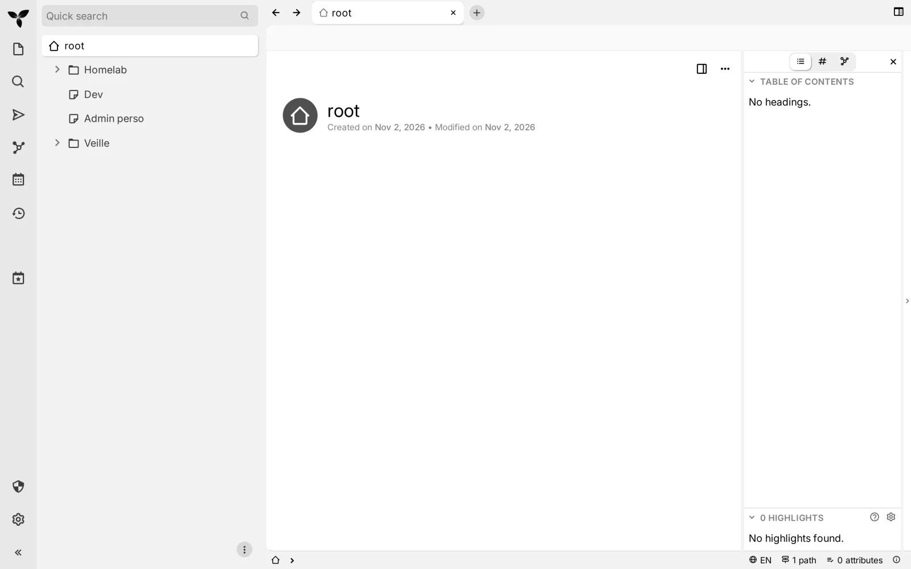
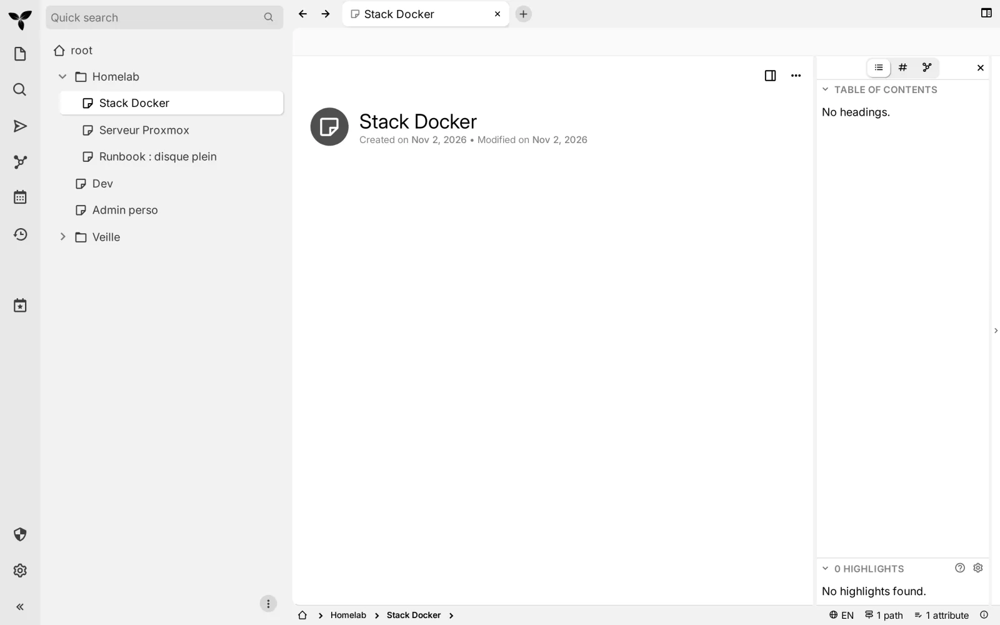
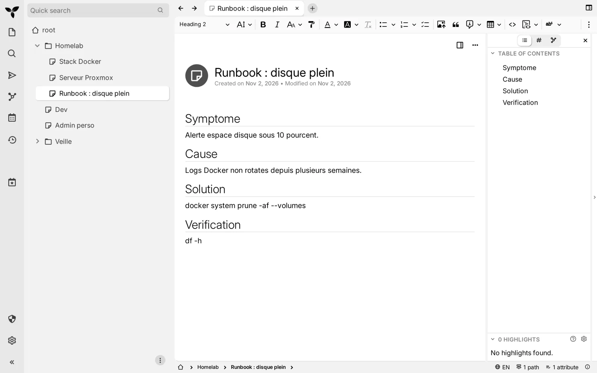

> 💡 **TL;DR**
> - TriliumNext est le fork communautaire actif de Trilium Notes (le projet de zadam, archivé en 2025), une base de connaissances perso en arborescence
> - TriliumNext Docker se déploie avec l'image officielle `triliumnext/trilium`, un seul volume, port 8080
> - Chiffrement par note, attributs scriptables, recherche plein texte et API ETAPI pour automatiser
> - Synchronisation multi-appareils via ton propre serveur, sans dépendre d'un cloud tiers

## Pourquoi j'ai remplacé mon tas de fichiers Markdown par TriliumNext

Pendant des années, j'ai stocké mes procédures d'admin système dans un dossier de fichiers Markdown, triés tant bien que mal par sous-dossiers. Ça fonctionnait, jusqu'au jour où j'ai eu besoin de retrouver une commande précise, planquée dans un fichier dont j'avais oublié jusqu'au nom. J'ai perdu vingt minutes à grep tout le dossier. Spoiler : ça va marcher, mais ce n'est pas une organisation, c'est de l'archéologie.

**TriliumNext Docker** résout ce problème précis. C'est une application de prise de notes hiérarchique, pensée pour construire une grande base de connaissances personnelle qui reste consultable des années plus tard, pas juste pour jeter des idées en vrac. Chaque note vit dans un arbre, peut être clonée à plusieurs endroits à la fois, peut porter des attributs qui servent à l'interroger ou à la scripter, et peut être chiffrée individuellement si son contenu est sensible.

Le projet est le fork communautaire actif de Trilium Notes, l'application créée par le développeur connu sous le pseudonyme zadam. Ce dépôt original a été archivé le 24 juin 2025 et est désormais en lecture seule. Le développement continue sous l'organisation TriliumNext, avec la même licence AGPL-3.0 et un format de données strictement compatible : si tu avais déjà des notes Trilium, elles s'ouvrent sans conversion.

## Table des matières

## Ce que fait une instance TriliumNext Docker concrètement

Avant de foncer sur le Docker Compose, un point rapide sur ce que tu obtiens une fois l'instance TriliumNext Docker en ligne :



- **Arborescence infinie et clonage** : une note peut avoir des centaines de sous-notes, et une même note peut apparaître à plusieurs endroits de l'arbre sans être dupliquée. Pratique pour une procédure qui concerne à la fois « Docker » et « Sécurité ».
- **Chiffrement par note** : tu marques une note comme protégée, elle demande un mot de passe de session pour s'afficher. Le reste de ton wiki reste accessible normalement. Pas de chiffrement global tout ou rien.
- **Attributs** : des paires clé/valeur attachées à une note, qui servent à filtrer des recherches, à déclencher des scripts, ou à construire des vues type tableau de bord.
- **Recherche plein texte** : rapide, avec une syntaxe de requête qui va au-delà d'un simple mot-clé (recherche par attribut, par date de modification, par type de note).
- **API ETAPI** : une API REST pour automatiser la création ou la lecture de notes depuis un script externe.
- **Scripting et widgets personnalisés** : TriliumNext permet d'exécuter du JavaScript côté note pour construire des vues sur mesure, un peu comme des mini-plugins internes.
- **Export/Import** : chaque note (ou sous-arbre entier) s'exporte en Markdown, HTML ou format natif `.zip` pour archivage ou migration.

Si ton besoin est plus proche d'un wiki d'équipe structuré avec étagères et permissions, regarde plutôt du côté de [Paperless-ngx pour le bureau numérique](/paperless-ngx-docker-guide-auto-hebergement/) côté documents scannés, ou complète ta stack productivité avec [Vikunja pour les tâches](/vikunja-docker-gestionnaire-taches/). TriliumNext reste avant tout une base de connaissances personnelle, pas un outil collaboratif temps réel.

## Prérequis avant de lancer ton TriliumNext Docker

- Un serveur Linux avec Docker Engine et Docker Compose (le plugin `docker compose`, pas l'ancien `docker-compose` en Python)
- Peu de CPU et de RAM pour un usage personnel : TriliumNext n'a pas besoin d'un serveur dédié, un petit VPS ou une VM de ton homelab suffit
- De l'espace disque selon le volume de notes et de pièces jointes que tu comptes y stocker
- Un nom de domaine ou sous-domaine si tu veux exposer l'instance derrière HTTPS
- Un reverse proxy (Caddy, Nginx Proxy Manager ou Traefik) pour gérer le certificat SSL

Si tu gères déjà plusieurs stacks Docker sur ton serveur, [Dockge est une interface web pratique pour les administrer sans retaper des commandes](/dockge-docker-gestionnaire-stacks-compose/) à chaque mise à jour. Tu peux y coller le Compose de TriliumNext à côté de tes autres services.

## Installer TriliumNext Docker avec Compose

Crée un dossier dédié pour ton instance TriliumNext Docker :

```bash
mkdir -p ~/triliumnext && cd ~/triliumnext
```

Voici le `docker-compose.yml` recommandé par la documentation officielle. Remplace `[VERSION]` par une version précise (par exemple `v0.106.1`) : la documentation déconseille le tag `latest`, qui peut mettre à jour l'instance vers une version mineure inattendue et perturber une synchronisation déjà configurée.

```yaml
services:
  triliumnext:
    image: triliumnext/trilium:[VERSION]
    container_name: triliumnext
    restart: unless-stopped
    ports:
      - "127.0.0.1:8080:8080"
    volumes:
      - ./trilium-data:/home/node/trilium-data
    environment:
      - TZ=Europe/Paris
```

Le binding `127.0.0.1:8080:8080` garde le port fermé au reste du réseau : seul ton reverse proxy local peut y accéder. Si tu veux exposer l'instance directement sur ton réseau local sans proxy, remplace par `0.0.0.0:8080:8080`, mais c'est à réserver à un LAN de confiance.

Lance le conteneur :

```bash
docker compose up -d
```

Accède ensuite à `http://IP-du-serveur:8080` (ou via ton proxy si tu en as mis un). Au premier lancement, ton TriliumNext Docker te demande de définir un mot de passe pour ton compte unique : il n'y a pas de notion multi-utilisateur native comme sur un wiki d'équipe, c'est bien un outil personnel.

Si le conteneur refuse de démarrer ou boucle, va voir les logs directement :

```bash
docker compose logs -f triliumnext
```

Ou utilise [Dozzle pour suivre les logs de tous tes conteneurs en temps réel depuis une interface web](/dozzle-docker-visionneuse-logs-web/), plus confortable qu'un terminal SSH quand tu dépannes plusieurs services à la fois.

### Avec un reverse proxy Caddy

```caddy
notes.tondomaine.com {
    reverse_proxy triliumnext:8080
}
```

### Avec Nginx Proxy Manager

1. Ajoute un proxy host pour `notes.tondomaine.com`
2. Forward hostname : `triliumnext`
3. Forward port : `8080`
4. Active « Block Common Exploits » et demande un certificat SSL
5. Force SSL et active HSTS

### Image rootless

Si tu préfères ne pas faire tourner le conteneur en root, TriliumNext fournit une variante rootless : `triliumnext/trilium:rootless` (basée sur Debian) ou `triliumnext/trilium:rootless-alpine`. Le dépôt officiel fournit un fichier `docker-compose.rootless.yml` séparé, avec des variables `TRILIUM_UID` et `TRILIUM_GID` à adapter à ton utilisateur hôte.

## Configuration initiale de TriliumNext Docker : structurer ton arbre de notes

Une fois connecté, résiste à l'envie de tout créer en vrac. Voici l'organisation que j'utilise chez moi après plusieurs mois d'usage :



**1. Une racine par domaine**
Je pars de quatre branches racines : `Homelab`, `Dev`, `Admin perso`, `Veille`. Chaque nouvelle note trouve sa place sous une de ces quatre portes d'entrée, ou se clone dans plusieurs si elle concerne deux domaines à la fois.

**2. Des attributs plutôt que des dossiers dupliqués**
Au lieu de recréer une note « Docker » sous chaque racine, j'attache un attribut `#techno=docker` à la note concernée. Une recherche par attribut retrouve ensuite tout ce qui touche à Docker, peu importe où la note vit dans l'arbre.

**3. Les notes protégées pour le sensible**
Les mots de passe temporaires, les clés d'accès, les notes RH : je les marque comme protégées. Elles demandent le mot de passe de session avant de s'afficher, même si quelqu'un a accès à mon compte ouvert.

**4. Les modèles de note**
TriliumNext permet de définir des notes modèles. J'en ai une pour « Procédure de dépannage » (sections Symptôme / Cause / Solution / Vérification) et une pour « Fiche service auto-hébergé » (version, port, volume, lien de doc). Ça évite de repartir d'une page blanche à chaque nouvelle entrée.

**5. La recherche avant la navigation**
Le raccourci de recherche plein texte devient vite ton réflexe numéro un, plus rapide que de descendre dans l'arborescence à la souris.

## Sauvegarde et mise à jour de ton TriliumNext Docker

Ton volume `./trilium-data` contient toute ta base de connaissances : la configuration, les notes et les pièces jointes. C'est un simple dossier à sauvegarder régulièrement :

```bash
#!/bin/bash
# backup-triliumnext.sh
DATE=$(date +%Y%m%d_%H%M%S)
tar czf "/backup/triliumnext_$DATE.tar.gz" ~/triliumnext/trilium-data
```

Ton TriliumNext Docker propose aussi un export natif complet depuis l'interface (clic droit sur la racine > Exporter), au format `.zip`, utile en complément d'une sauvegarde système pour vérifier que tes notes restent lisibles hors de l'application.

Pour les mises à jour, change la version dans ton `docker-compose.yml` plutôt que de laisser `latest` faire le travail à ta place :

```bash
cd ~/triliumnext
docker compose pull
docker compose up -d
```

⚠️ Vérifie les notes de version avant de sauter plusieurs versions mineures d'un coup, surtout si tu utilises la synchronisation entre plusieurs appareils : un décalage de version entre client et serveur de sync peut bloquer la synchronisation jusqu'à mise à niveau des deux côtés.

## Synchronisation entre plusieurs appareils avec TriliumNext Docker

TriliumNext n'est pas qu'une app desktop isolée. Le même serveur TriliumNext Docker que tu viens de déployer peut faire office de serveur de synchronisation pour :

- Le client desktop natif (Windows, macOS, Linux), à utiliser hors ligne puis synchroniser ponctuellement
- L'interface web, accessible depuis n'importe quel navigateur, y compris mobile
- Des applications tierces non officielles comme TriliumDroid sur Android

La synchronisation passe par ton propre serveur : aucune donnée ne transite par un service tiers. Configure l'URL de ton serveur dans les options de synchronisation du client desktop, lance une première synchro, et toute modification ultérieure se propage automatiquement en arrière-plan.

✅ C'est l'argument qui m'a convaincu de migrer mes notes depuis un outil cloud : je garde le confort de plusieurs appareils synchronisés, sans qu'aucune de mes notes techniques (accès serveur compris) ne quitte mon infrastructure.

## Sécuriser l'accès à ta base de connaissances

Un wiki perso contient souvent des informations qu'on préfère garder privées. Quelques réflexes de base :

**HTTPS systématique**
Si tu exposes TriliumNext sur Internet, ton reverse proxy doit forcer le HTTPS. Ne laisse jamais le port 8080 ouvert en clair sur une IP publique.

**Mot de passe fort pour le compte unique**
Une instance TriliumNext Docker n'a qu'un compte par instance : protège-le avec un mot de passe long et unique, et envisage de placer l'accès derrière un VPN comme WireGuard plutôt que de l'exposer publiquement.

**Notes protégées pour le contenu sensible**
Comme vu plus haut, le chiffrement par note est ta deuxième ligne de défense si quelqu'un accède quand même à une session ouverte.

**Sauvegardes chiffrées hors site**
Le dossier `trilium-data` contient tes notes en clair sur le disque (le chiffrement par note protège l'affichage dans l'interface, pas le fichier de base de données sous-jacent). Une sauvegarde chiffrée vers un stockage externe reste indispensable. Si tu archives aussi tes exports dans un dépôt Git versionné, [GitLab CE en self-hosted peut servir de forge privée pour ça](/gitlab-ce-docker-forge-cicd-complete/), avec l'historique de chaque modification en plus.

## Cas d'usage concrets pour un homelab

**Documentation d'infrastructure**
Chaque VM, chaque conteneur, chaque règle de pare-feu a sa fiche : IP, ports, date de déploiement, procédure de restauration. Quand un service tombe à 23h un dimanche, tu retrouves la procédure en deux clics plutôt qu'en refaisant les recherches que tu avais déjà faites six mois plus tôt.



**Runbooks d'incident**
Une note par type d'incident récurrent (disque plein, certificat expiré, service qui boucle), avec les commandes exactes à copier-coller. Le chiffrement par note s'applique bien quand une procédure contient un token d'accès.

**Veille technique**
Les attributs permettent de tagger chaque article ou outil repéré en veille (`#statut=a-tester`, `#statut=adopte`), puis de faire une recherche par attribut pour retrouver tout ce qui reste à essayer.

**Carnet de bord pour fichiers et snippets**
Pour les pièces jointes volumineuses que tu ne veux pas stocker directement dans TriliumNext, [Filestash expose tes fichiers existants via une interface web universelle](/filestash-docker-navigateur-fichiers-web/) et tu te contentes de référencer le lien dans la note correspondante.

## Conclusion

TriliumNext Docker n'a pas la prétention d'un Notion ou d'un Confluence. C'est un outil personnel, pensé pour une seule tête qui accumule de la connaissance technique sur le long terme et qui veut la retrouver sans effort trois ans plus tard. L'arborescence infinie, le clonage de notes et les attributs scriptables en font un outil qui tient la charge d'un vrai homelab documenté, pas juste d'un carnet de notes.

Si tu en as marre de perdre tes procédures dans un dossier de fichiers Markdown non structuré, l'installation de TriliumNext Docker prend dix minutes et le format de données reste strictement compatible avec l'historique du projet. Mon conseil : commence par une seule racine, celle de ton homelab, et laisse l'arborescence grossir naturellement plutôt que de vouloir tout planifier à l'avance. Elle finit toujours par ressembler à ta façon de penser, pas à un plan posé sur papier.
